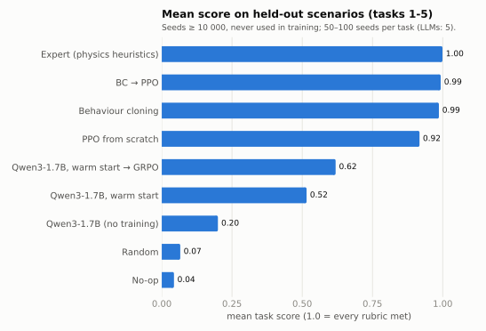
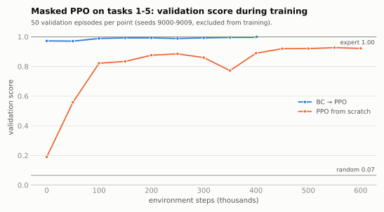
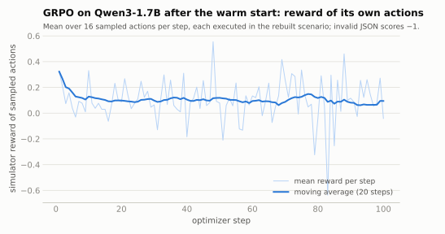

# ⚡ NexusGrid — a power-grid operations benchmark for RL and LLM agents

[](https://github.com/AbineshSenthil/NexusGrid-CyberPhysEnv/actions/workflows/ci.yml)
[](LICENSE)

NexusGrid puts an agent in the control room of a 20-bus transmission grid. It has to keep frequency
inside 59.8–60.2 Hz through an evening demand ramp, relieve line overloads before protection relays
cascade, find and quarantine a SCADA channel that is hiding a real loss of generation, damp a
forced oscillation without disconnecting the unit, and restart the grid after a blackout.

It is an [OpenEnv](https://github.com/meta-pytorch/OpenEnv) environment (FastAPI + WebSocket) with a
Gymnasium wrapper for RL and a text interface for language models.

**What makes the scores trustworthy**

- **Every seed is a new scenario.** Disturbance, location, timing and operating point come from the
  episode seed. Seeds ≥ 10 000 are held out, and the Task 2 contingencies are split 192 train / 48 test.
- **Physics decides the outcome.** DC power flow per island, governor response and inertia, ramp limits,
  relay protection, under-frequency load shedding and island collapse. Graders read the physical
  trajectory, not the action names.
- **Trivial policies fail.** On held-out seeds, doing nothing scores **0.04** and random actions **0.08**;
  a hand-written physics expert scores **1.00**.
- **No hidden state leaks.** The attacked bus, oscillation mode and hidden megawatts never appear in
  observations.

**Learned agents** (held-out seeds, tasks 1–5): masked PPO scores 0.92 from scratch and 0.99 with
behaviour cloning. Qwen3-1.7B goes from 0.20 untrained to 0.52 after a warm start on expert actions and
0.62 after GRPO, all trained on one 8 GB laptop GPU.

> Version 3.0 rebuilt the benchmark; see [CHANGELOG.md](CHANGELOG.md). The archived v2 hackathon
> write-up is in [docs/blog-v2-hackathon.md](docs/blog-v2-hackathon.md).

---

## Results

All numbers are mean task scores (0–1) on **held-out evaluation seeds**, reproducible with the commands
in [Reproduce](#reproduce).



### Baselines (100 seeds per task)

| Task | No-op | Random | Expert |
|---|---|---|---|
| 0 · smoke test | 0.000 | 0.130 | 1.000 |
| 1 · duck curve | 0.131 | 0.157 | 1.000 |
| 2 · cascade overload | 0.050 | 0.046 | 1.000 |
| 3 · phantom injection | 0.000 | 0.046 | 0.999 |
| 4 · forced oscillation | 0.036 | 0.054 | 0.997 |
| 5 · black start | 0.000 | 0.026 | 1.000 |
| **Mean** | **0.036** | **0.077** | **0.999** |

The **expert** (`policies.ExpertPolicy`) uses only the observation: forecast-aware frequency control,
a DC power-flow model rebuilt from metered line flows to check every redispatch or switching action,
evidence-first incident response, oscillation damping and staged black-start restoration. It shows
that every scenario is solvable; it is not an upper bound for learned agents.

### Reinforcement learning (50 held-out seeds per task)

One masked PPO policy ([sb3-contrib](https://github.com/Stable-Baselines-Team/stable-baselines3-contrib))
for tasks 1–5 on the Gymnasium wrapper (`gym_env.py`: 722 features, 237 discrete actions with validity
masks). Trained on CPU with 4 environments; 22–30 minutes per run.

| Agent | Duck curve | Cascade | Phantom | Oscillation | Black start | Mean |
|---|---|---|---|---|---|---|
| PPO from scratch (600k steps) | 1.000 | 0.644 | 1.000 | 0.959 | 0.985 | 0.917 |
| Behaviour cloning (600 expert episodes) | 0.999 | 1.000 | 0.999 | 0.935 | 1.000 | 0.986 |
| BC → PPO (+400k steps) | 1.000 | 0.997 | 1.000 | 0.968 | 1.000 | **0.993** |



- PPO from scratch learns frequency control, incident response and black start within 600k steps, but
  not cascade relief: Task 2 reaches only 0.74 on training contingencies and 0.64 on the 48 held-out ones.
- Cloning 600 expert episodes closes that gap. PPO fine-tuning then keeps the cloned behaviour and
  nudges Task 4 up (0.935 → 0.968; the 95 % intervals overlap).

### Language models (5 held-out seeds per task)

Qwen3-1.7B (4-bit, [Unsloth](https://github.com/unslothai/unsloth)) acts as a **pure** operator: it
reads the compact text observation and must answer with one JSON action. An unparseable reply becomes
`advance_tick` and is counted; no expert fallback is used.

Training (`training/train_grpo.py`) fits one LoRA adapter (r = 16) on an 8 GB RTX 4060 Laptop GPU in two
phases, both on training seeds only (13 + 31 minutes):

1. **Warm start**: supervised fine-tuning on the expert's action in 1,098 states from 200 episodes
   (the expert is perturbed by 25 % random actions, so off-nominal states are covered).
2. **GRPO**: 100 steps, 8 sampled actions per prompt. Each sample is executed in the exact rebuilt
   scenario and scored by the simulator over the next two ticks; invalid JSON scores −1. Prompts are
   *decisive* states, where acting like the expert beats waiting; the expert never enters the reward.

| Model | Smoke | Duck curve | Cascade | Phantom | Oscillation | Black start | Mean 1–5 |
|---|---|---|---|---|---|---|---|
| Qwen3-1.7B, no training | 1.000 | 0.680 | 0.157 | 0.000 | 0.083 | 0.080 | 0.200 |
| Qwen3-1.7B, warm start | 1.000 | 0.713 | 0.406 | 0.600 | 0.615 | 0.243 | 0.515 |
| Qwen3-1.7B, warm start → GRPO | 1.000 | 0.633 | 0.800 | 0.600 | 0.230 | 0.831 | **0.619** |

Without training, the model reacts early to the duck curve but overshoots, lets relays trip during the
cascade (17 trips in 5 episodes), never gathers evidence in the phantom attack, never counters the
oscillation (the turbine is lost every time), and in black start energises the first unit but then
collapses the island again and again (48 collapses in 5 episodes). An earlier, more verbose observation
format scored 0.10 on tasks 1–5 with the same model ([archive](results/llm/archive/)); the compact format
alone doubled that.

- **The warm start does most of the incident work.** The model learns to gather state-estimation
  evidence before quarantining (3 of 5 phantom attacks solved, none before) and to answer the
  oscillation with a matched counter-signal (3 of 5).
- **GRPO fixes what imitation left.** Every cascade is relieved with no relay trip (9 trips before),
  though frequency leaves the band each time, which caps those episodes at 0.80. Black start rises from
  0.24 to 0.83, scoring 0.75–0.92 in every scenario (island collapses 8 → 1, load-shedding events 54 → 14).
- **GRPO also lost ground** on the oscillation (0.62 → 0.23; turbines lost 2 → 4) and slightly on the duck
  curve (0.71 → 0.63, more overshoot). The cause is not diagnosed yet; only about one prompt in six was an
  oscillation state. Per-task reward balancing and a longer reward horizon are the next experiments.
- GRPO started from the untrained model got almost no signal: in 72 % of prompt groups all 8 sampled
  actions earned the same reward, so there was no advantage to follow. We stopped that run after 14
  steps and added the warm start.
- With 5 seeds per task, per-task differences below about 0.2 are within noise; all three rows use the
  same held-out scenarios.



The training reward stays flat because every step draws different scenarios with different reward
scales; the held-out table above is the measure of progress.

---

## The environment

### Grid and physics (`server/grid_engine.py`)

- 20 buses in five regions: hydro, gas, solar and battery plants, seven loads (four critical: two
  hospitals, water treatment, a data centre), 40 lines with ratings from 300 to 1200 MW.
- **DC power flow** on every energised island (`B θ = P`, reactance scaled by line rating).
- **Frequency**: island frequency follows `60 + mismatch / K` with `K = 0.25 MW/Hz` per MW of online
  dispatchable capacity, approached with first-order inertia. Governors absorb the mismatch physically;
  the operator acts as AGC by changing setpoints (ramp limits: hydro 250 MW/tick, gas 150 MW/tick).
- **Protection**: lines above 100 % trip after three ticks and instantly at 140 %; UFLS sheds 10 % steps of
  non-critical load below 59.2 Hz; islands collapse outside 58.8–61.2 Hz; closing a breaker between
  islands needs Δf ≤ 0.2 Hz and Δθ ≤ 20°.
- **SCADA layer** (`server/spoof_engine.py`): telemetry with measurement noise, packet logs with
  latency anomalies (attack command-and-control traffic plus decoys), Kirchhoff state estimation.

### Tasks

| # | Task | Horizon | What changes with the seed | What the grader checks |
|---|---|---|---|---|
| 0 | Smoke test | 3 | load, solar | a valid positive dispatch, frequency still in band |
| 1 | Duck curve | 15 | size and timing of the evening ramp, sunset speed, clouds | time in band, no UFLS, acting before the drop, no overshoot |
| 2 | Cascade overload | 20 | one of 240 validated storm contingencies | overloads cleared before relays act, critical loads kept, load served, frequency |
| 3 | Phantom injection | 18 | attacked plant, start, loss rate/size, decoys | proof by state estimation before quarantine, timing, recovery, triage efficiency |
| 4 | Forced oscillation | 12 | oscillating unit, mode 0.30–0.80 Hz, growth, onset | matched counter-signal from a battery ≤ 2 hops away, unit saved and detuned, rebalanced |
| 5 | Black start | 50 | black-start unit, load level | critical loads first, total load restored, no collapses or out-of-phase closures |

Rubric weights are in [`openenv.yaml`](openenv.yaml) and `GET /tasks`. Extra gates: a collapse below
59.0 Hz zeroes Task 1, disconnecting the oscillating unit zeroes Task 4, each refused quarantine costs 0.1,
and in Tasks 1, 3 and 4 every percentage point of demand left unserved (below 99 %) costs 5 % of the score.

### Actions

| Action | Arguments |
|---|---|
| `dispatch_generation` | `node_id`, `mw` (setpoint change, ramp-limited) |
| `shed_load` | `node_id`, `mw` (negative restores manual or UFLS-shed load) |
| `toggle_circuit_breaker` | `edge_id`, `status` = `OPEN` \| `CLOSED` |
| `run_state_estimation` | `subgraph` (≤ 6 buses) |
| `quarantine_scada_node` | `node_id` (needs prior evidence) |
| `inject_counter_signal` | `node_id` (battery), `hz_offset`, `duration` |
| `advance_tick` | — |

### Observation

`topology_graph` (buses, setpoints, line flows and loading — never spoofed), `telemetry_stream` (last
10 ticks of SCADA/PMU readings — generation can be falsified), `network_packet_logs`,
`grid_frequency_hz`, `islands`, `forecast` (demand and solar for the next six ticks), `events`,
`last_state_estimation`, `active_counter_signals`, `task_brief`, `score` and `rubric_scores`.

### Reward

`reward = Δscore + 0.02·[f in band] − 0.02·(overloaded lines) − event penalties − 0.05·[invalid action]`.
The Δscore terms telescope to the final grade, so return and score agree. Early completion of the black
start pays the remaining in-band bonus at once, so finishing early is never worse than stalling.

---

## Quickstart

```bash
pip install -r requirements.txt            # Python 3.10+
uvicorn server.app:app --port 8000         # API on :8000, dashboard on /web
```

```python
from client import NexusgridEnv
from models import GridAction

with NexusgridEnv(base_url="http://localhost:8000").sync() as env:
    result = env.reset(seed=10_000, task_id=1)          # held-out duck-curve scenario
    result = env.step(GridAction(action_type="dispatch_generation", node_id="NODE_13", mw=150))
    print(result.observation.grid_frequency_hz, result.observation.score)
```

Use the WebSocket client (above) for multi-step episodes; plain `POST /reset` and `POST /step` create
a fresh environment per request. In-process use needs no server:

```python
from server.nexusgrid_environment import NexusgridEnvironment
from policies import ExpertPolicy

env, policy = NexusgridEnvironment(), ExpertPolicy()
obs = env.reset(seed=10_003, task_id=3)
while not obs.done:
    obs = env.step(policy.act(obs))
print(env.get_score(), env.debug_state()["attack"])     # debug_state is for humans, not agents
```

### Run a language model as the operator

Any OpenAI-compatible endpoint works (Ollama, vLLM, LM Studio, OpenAI, Hugging Face router):

```bash
cp .env.example .env                     # API_BASE_URL, MODEL_NAME, API_KEY
python inference.py --tasks 1,3 --seeds 10000,10001
python scripts/evaluate.py --policies llm --model qwen3:1.7b --seeds 5
```

The model sees a compact text rendering of the observation (`inference.render_observation`) and must
reply with one JSON action. Evaluation is **pure** by default: an unparseable reply becomes
`advance_tick` and is counted. `--fallback` substitutes the expert's action and reports how often.

## Reproduce

```bash
# Baselines on held-out seeds (about 2 minutes on a laptop)
python scripts/evaluate.py --policies noop,random,expert --seeds 100 --out results/baselines

# RL on CPU (pip install -e .[rl]); BC → PPO, then PPO from scratch
python training/train_ppo.py --tasks 1,2,3,4,5 --bc-episodes 600 --bc-epochs 40 --timesteps 400000 \
    --learning-rate 1e-4 --ent-coef 0.003 --eval-every 50000 --out runs/ppo/bc
python training/train_ppo.py --tasks 1,2,3,4,5 --timesteps 600000 --eval-every 50000 --out runs/ppo/scratch
python scripts/evaluate.py --policies ppo --ppo-model runs/ppo/bc/best.zip --tasks 1,2,3,4,5 --seeds 50
python scripts/evaluate.py --policies ppo --ppo-model runs/ppo/bc/bc.zip --tasks 1,2,3,4,5 --seeds 50
python scripts/make_figures.py                # README charts from results/

# LLM: GRPO with simulator rewards (pip install -e .[grpo]; tested on an 8 GB RTX 4060 Laptop GPU)
M=unsloth/Qwen3-1.7B-unsloth-bnb-4bit
python training/eval_llm_local.py --backend unsloth --model $M --seeds 5 --out results/llm/qwen3-1.7b-base
python training/train_grpo.py --backend unsloth --model $M --load-in-4bit --out runs/grpo/qwen3-1.7b
python training/eval_llm_local.py --backend unsloth --model $M --adapter runs/grpo/qwen3-1.7b/sft_adapter \
    --label llm-sft --seeds 5 --out results/llm/qwen3-1.7b-sft
python training/eval_llm_local.py --backend unsloth --model $M --adapter runs/grpo/qwen3-1.7b/adapter \
    --seeds 5 --out results/llm/qwen3-1.7b-grpo
# Windows: double-click training\run_local_gpu.cmd (the same steps, logs in runs\grpo\)
```

The GRPO reward rebuilds the exact state of each prompt (the simulator is deterministic), executes the
model's own action, then advances two passive ticks and sums the environment's rewards — so delayed
consequences such as relay trips count, and no scripted fallback is ever credited to the model.

## Project layout

```
server/            environment: grid_engine, scenarios (+ data/cascade_catalog.json), spoof_engine,
                   rubric, graders, reward, nexusgrid_environment, app (FastAPI), dashboard (Gradio)
models.py          typed actions and observations      client.py     WebSocket client
policies.py        no-op, random and expert baselines  inference.py  LLM operator runner
gym_env.py         Gymnasium wrapper, action catalogue and masks, PPO policy loader
training/          train_ppo.py, train_grpo.py, grpo_common.py, eval_llm_local.py, plots.py,
                   run_local_gpu.ps1 / .cmd (Windows GPU pipeline)
scripts/           evaluate.py, make_figures.py, build_scenario_catalog.py
tests/             physics, scenarios, environment, graders, policies, API, dashboard, training
results/           evaluation summaries (baselines, PPO, LLM) behind every number in this README
docs/figures/      charts generated by scripts/make_figures.py
```

## Limitations

- DC power flow ignores voltage magnitudes, reactive power and losses; frequency dynamics are a
  first-order aggregate, not a transient-stability simulation.
- The 20-bus network is synthetic. Task 2 scenarios come from a searched catalog rather than a utility
  contingency list.
- Attacks are stylised models of false-data injection and forced oscillations.
- Scores depend on the rubric design documented above; the expert shows solvability, not optimality.

## License

MIT — see [LICENSE](LICENSE). Built by Abinesh Senthilkumar; started for the Meta PyTorch OpenEnv
Hackathon 2026.
